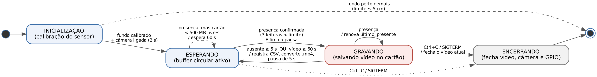

# ⚙️ Análise da Máquina de Estados (FSM)

**Projeto:** Camera Trap para Observação de Animais
**Módulo:** `src/cameratrap/logica.py` (classes `FiltroPresenca` e `MaquinaEstados`) e `src/cameratrap/app.py`

## 1. Visão geral

A decisão de **quando gravar** é feita por uma **máquina de estados finita (FSM)**. Com ela, o sistema está sempre num estado conhecido e determinístico. Isso evita situações inválidas, como abrir dois vídeos ao mesmo tempo, gravar sem parar enquanto um animal fica parado na frente do sensor, ou encher o cartão.

A FSM fica isolada em `logica.py` e **não acessa hardware**. Ela recebe números (distância e horário) e devolve uma ação (`INICIAR_GRAVACAO`, `PARAR_GRAVACAO` ou `NENHUMA`). Por isso pode ser testada no computador, sem o Raspberry Pi (seção 6).

---

## 2. Diagrama de estados

O arquivo-fonte do diagrama está em `docs/img/fontes/maquina_estados.dot`. Para gerar a imagem de novo: `dot -Tpng -Gdpi=150 maquina_estados.dot -o ../maquina_estados.png`.

---

## 3. Definição dos estados

| Estado | Descrição | Hardware ativo |
| :--- | :--- | :--- |
| **INICIALIZAÇÃO** | Mede o fundo vazio por `TEMPO_CALIBRACAO` (5 s), calcula o limite de disparo e liga a câmera. | Sensor (calibração), câmera ligando |
| **ESPERANDO** | Ocioso. A câmera mantém os últimos `SEGUNDOS_ANTES` (3 s) num buffer circular na memória. O sensor é lido 10 vezes por segundo. | Sensor, câmera (só buffer) |
| **GRAVANDO** | O vídeo está sendo salvo no cartão, incluindo o conteúdo do buffer. | Sensor, câmera, cartão SD |
| **ENCERRANDO** | Fecha o vídeo em andamento, desliga a câmera e libera os pinos GPIO. | — |

O estado **INICIALIZAÇÃO** fica na função `calibrar()` de `app.py`. Os estados **ESPERANDO** e **GRAVANDO** são o enum `Estado` de `logica.py`. **ENCERRANDO** é o bloco `finally` de `app.main()`.

---

## 4. Tabela de transições

Os valores entre parênteses são os padrões de `config.py`.

| Estado atual | Evento / condição | Próximo estado | Ação | Justificativa |
| :--- | :--- | :--- | :--- | :--- |
| `INICIALIZAÇÃO` | Calibração concluída e limite > 5 cm | `ESPERANDO` | Liga a câmera e espera 2 s | O sensor e a exposição da câmera estabilizam antes de vigiar. |
| `INICIALIZAÇÃO` | Limite ≤ 5 cm (fundo perto demais) | fim | Encerra com erro | Com o fundo colado no sensor, nenhuma detecção seria confiável. |
| `ESPERANDO` | Presença confirmada (`LEITURAS_PARA_DISPARAR` = 3 leituras seguidas abaixo do limite) **e** fim da pausa | `GRAVANDO` | `Acao.INICIAR_GRAVACAO` | Exigir leituras seguidas evita disparos por uma leitura errada. |
| `ESPERANDO` | Presença confirmada, mas cartão com < `ESPACO_MINIMO_MB` (500 MB) | `ESPERANDO` | `cancelar()`: nova tentativa só após 60 s | Não grava com o cartão quase cheio, o que protege o sistema. |
| `GRAVANDO` | Presença continua | `GRAVANDO` | Atualiza `último_presente` | O vídeo dura enquanto o animal estiver lá. |
| `GRAVANDO` | Sem presença há ≥ `SEGUNDOS_DEPOIS` (5 s) | `ESPERANDO` | `Acao.PARAR_GRAVACAO`, registra o CSV, converte para .mp4 | Ausências curtas, como o animal se mexendo, não cortam o vídeo. |
| `GRAVANDO` | Vídeo com ≥ `DURACAO_MAXIMA` (60 s) | `ESPERANDO` | `Acao.PARAR_GRAVACAO` | Limita o tamanho dos arquivos. Se o animal continuar, um novo vídeo começa após a pausa. |
| `ESPERANDO` / `GRAVANDO` | Ctrl+C ou `SIGTERM` (`systemctl stop`) | `ENCERRANDO` | Fecha o vídeo atual e registra a visita | Desligamento limpo, sem vídeo corrompido. |

Após cada `PARAR_GRAVACAO` existe uma **pausa** de `TEMPO_ESPERA` (5 s) antes de outro disparo.

---

## 5. Recursos de segurança e confiabilidade

1. **Filtro de presença.** O `FiltroPresenca` só confirma presença após N leituras seguidas abaixo do limite. Uma leitura "longe" no meio zera a contagem. Isso funciona como *debounce* do sensor.
2. **Histerese temporal.** Para iniciar são precisas 3 leituras (≈ 0,3 s). Para parar são precisos 5 s de ausência. A diferença evita que o sistema fique ligando e desligando a gravação.
3. **Calibração automática.** O limite é relativo ao fundo real do local (mediana das leituras), e não um valor fixo. A mediana ignora leituras isoladas erradas. O sistema avisa se a calibração foi instável ou se o sensor está lendo o máximo, o que pode indicar o Echo desligado.
4. **Duração máxima.** Nenhum vídeo passa de 60 s, mesmo que um animal fique parado na frente do sensor.
5. **Proteção do armazenamento.** Antes de cada gravação o espaço livre é verificado. Com o cartão cheio, a máquina volta a esperar sem gravar.
6. **Encerramento limpo.** `SIGINT` e `SIGTERM` são tratados: o vídeo em andamento é fechado e registrado antes de liberar a câmera e o GPIO.
7. **Recuperação.** Vídeos `.h264` que ficaram sem conversão, por exemplo por falta de energia, são convertidos na próxima inicialização. O serviço systemd reinicia o programa em caso de falha (`Restart=on-failure`).

---

## 6. Validação da FSM

Cada transição tem um teste automatizado em `tests/test_logica.py`, executado com `python3 -m unittest -v`:

| Teste | O que verifica |
| :--- | :--- |
| `test_comeca_esperando` | Estado inicial é `ESPERANDO`; sem presença não há ação. |
| `test_inicia_quando_ha_presenca` | `ESPERANDO → GRAVANDO` com presença. |
| `test_para_depois_que_o_animal_sai` | Continua gravando com 4 s de ausência e para com 5 s. |
| `test_para_na_duracao_maxima_mesmo_com_presenca` | Para aos 60 s mesmo com o animal presente. |
| `test_respeita_tempo_de_espera` | Não reinicia durante a pausa; reinicia depois dela. |
| `test_cancelar_volta_a_esperar` | Cartão cheio: volta a `ESPERANDO` e só tenta de novo após o tempo definido. |
| `test_precisa_de_leituras_seguidas` | O filtro só confirma na 3ª leitura seguida. |
| `test_leitura_longe_zera_contagem` | Uma leitura "longe" zera o filtro. |
| `test_usa_mediana_e_ignora_leitura_maluca` | A calibração ignora uma leitura isolada errada. |

Resultado na versão atual: **13 testes, todos aprovados**.
