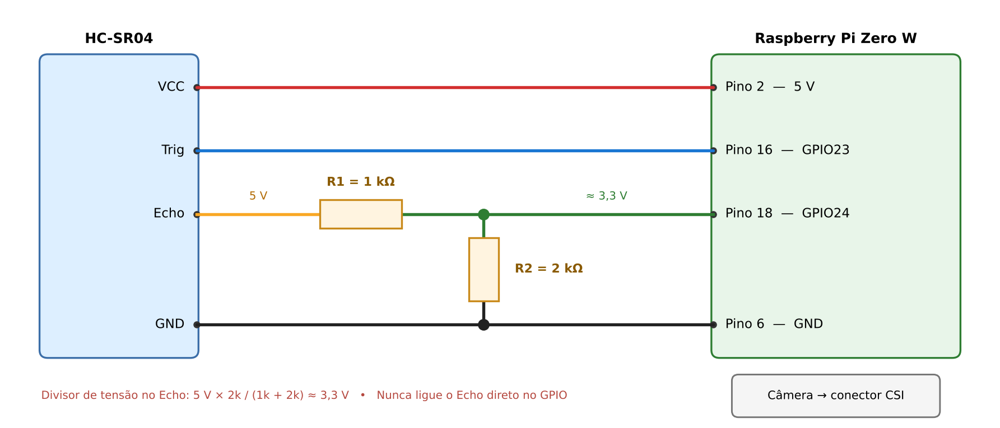
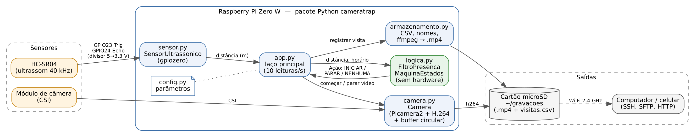
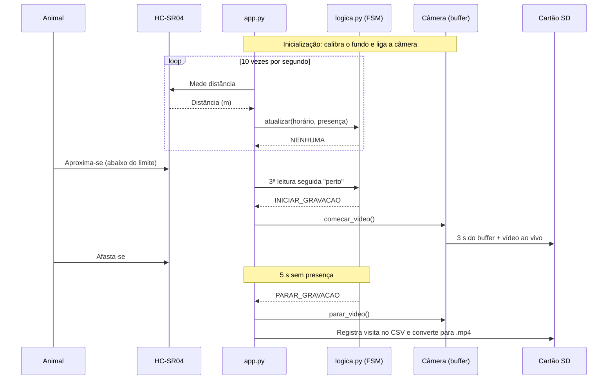

# Relatório Técnico

Projeto: Camera Trap para Observação de Animais (Raspberry Pi Zero W + HC-SR04)
=================================================================================

**Repositório:** [ThiagoVieiraCamara/camera_iot_UFRR](https://github.com/ThiagoVieiraCamara/camera_iot_UFRR)

**Autores:** **[Preencher]**
**Instituição / disciplina:** Universidade Federal de Roraima (UFRR) – **[Preencher: disciplina e código]**
**Licença:** MIT
**Data:** Novembro / 2026
**Categoria CAPES:** Protótipo, sistema, artefato ou processo computacional com validação funcional.

**Objetivo do relatório:** documentar a arquitetura tecnológica, os componentes, o funcionamento, a validação e os diferenciais do sistema.

**Justificativa:**

- É um sistema embarcado funcional, não apenas conceitual.
- Integra hardware (sensor, câmera, GPIO) e software (máquina de estados, gravação, registro).
- Tem documentação técnica: requisitos, diagramas, manual e documentação do código com Doxygen.
- É reproduzível e tem lógica validada por testes automatizados.

---

## 📌 1. Visão geral

O projeto é uma **armadilha fotográfica (*camera trap*)**: um sistema embarcado que **grava vídeos automaticamente quando um animal se aproxima** de um ponto vigiado, sem a presença de um observador humano.

Um sensor ultrassônico **HC-SR04** mede continuamente a distância até o fundo da cena. Quando algo fica mais perto que o normal, o **Raspberry Pi Zero W** salva um vídeo do módulo de câmera. O vídeo inclui os **segundos anteriores ao disparo**, graças a um buffer circular. Cada visita é registrada num arquivo CSV com data, hora, duração e distância mínima. O sistema opera sem monitor e é acessado pela rede Wi-Fi (SSH).

---

## 📐 2. Escopo da solução

Este relatório aborda:

* **Arquitetura tecnológica** (hardware e software)
* **Lógica de controle** (máquina de estados) e operação
* **Validação** (testes automatizados e testes com o hardware)
* **Diferenciais técnicos** em relação a trabalhos relacionados
* **Limitações, recomendações de evolução e conclusões**

### 📚 2.1 Trabalhos relacionados e análises complementares

Para fundamentar as decisões de projeto, foi feita uma comparação com quatro trabalhos acadêmicos (A1–A4) sobre camera traps e sobre o uso do Raspberry Pi em biologia. A comparação analisa os pontos em comum e, principalmente, os **métodos de disparo**: PIR, PIR com confirmação, gatilho ativo, filmagem contínua e ultrassom.

* **[📄 Leia a comparação completa com a literatura](comparacao_literatura.md)**

A lógica de controle é uma Máquina de Estados Finita (FSM). Estados, transições, recursos de segurança e testes de cada transição estão no documento de análise:

* **[⚙️ Leia a análise da máquina de estados](analise_maquina_estados.md)**

Decisões de montagem, posicionamento do sensor e lista de materiais:

* **[🧰 Leia a documentação de montagem física](montagem_fisica.md)**

---

## 🏗️ 3. Arquitetura tecnológica

### 🔌 3.1 Hardware

| Componente | Função principal | Características relevantes |
| ---------- | ---------------- | -------------------------- |
| **Raspberry Pi Zero W** | Unidade de controle e gravação | CPU de 1 GHz com 1 núcleo, 512 MB de RAM, Wi-Fi 2,4 GHz, conector de câmera CSI |
| **Módulo de câmera (CSI)** | Captura de vídeo | Codificação H.264 em hardware |
| **Sensor ultrassônico HC-SR04** | Detecção de aproximação | 5 V, ~15 mA, 40 kHz, alcance de 2 cm a 4 m, ângulo de ~15° |
| **Divisor de tensão (1 kΩ + 2 kΩ)** | Adapta o Echo (5 V) ao GPIO (3,3 V) | Protege o Raspberry Pi |
| **Cartão microSD** | Sistema, vídeos e registro | Recomendado tipo "High Endurance" |
| **Fonte 5 V / powerbank** | Alimentação | — |

**Diagrama de ligações:**



**Descrição da integração:** o Raspberry Pi lê o HC-SR04 pelos GPIO23 (Trig) e GPIO24 (Echo), dez vezes por segundo. A câmera fica ligada continuamente, com o codificador H.264 alimentando um buffer circular na memória. Quando a lógica de controle decide gravar, o conteúdo do buffer e os quadros seguintes são gravados no cartão. Detalhes elétricos em [`docs/ligacoes.md`](../ligacoes.md).

---

### 🧠 3.2 Software

#### 🗂️ 3.2.1 Organização do código

O software foi escrito em **Python 3**, com as bibliotecas `gpiozero` (sensor) e `Picamera2` (câmera). Ele está dividido em módulos com uma responsabilidade cada:

| Módulo | Responsabilidade | Usa hardware? |
| --- | --- | :---: |
| `config.py` | Todos os parâmetros ajustáveis (pinos, tempos, resolução) | Não |
| `logica.py` | Calibração, filtro de presença e máquina de estados | **Não** |
| `sensor.py` | Leitura do HC-SR04 | Sim |
| `camera.py` | Buffer circular e gravação de vídeo | Sim |
| `armazenamento.py` | Nomes de arquivo, log CSV, espaço livre, conversão para .mp4 | Não |
| `app.py` | Laço principal que integra os módulos | Sim |

A separação entre **lógica** e **hardware** permite testar toda a tomada de decisão no computador, sem o Raspberry Pi (seção 9).

#### 🔄 3.2.2 Máquina de estados

O ciclo de operação segue uma FSM:

1. **Inicialização:** calibra o sensor, medindo o fundo vazio por 5 s, e liga a câmera.
2. **Esperando:** a câmera mantém os últimos 3 s em memória enquanto o sensor é lido.
3. **Gravando:** iniciada quando 3 leituras seguidas ficam pelo menos 15 cm abaixo do fundo. Termina após 5 s sem presença ou ao chegar a 60 s de vídeo.
4. **Registro:** a visita vai para o CSV, o vídeo é convertido para .mp4 e o sistema volta a esperar, após 5 s de pausa.

Veja a [análise completa da FSM](analise_maquina_estados.md).

#### 🎞️ 3.2.3 Buffer circular (gravação pré-disparo)

Num camera trap comum, o vídeo começa só depois do disparo, e o momento da chegada do animal se perde. Aqui, o codificador H.264 escreve continuamente num **buffer circular em memória** (`CircularOutput` da Picamera2), com os últimos 3 segundos. Quando a gravação começa, esse conteúdo é gravado primeiro no arquivo. O cartão SD só recebe dados durante as visitas, o que economiza espaço e desgaste.

#### 💾 3.2.4 Armazenamento e registro

* Vídeos nomeados por data e hora: `AAAA-MM-DD_HH-MM-SS.mp4`.
* Registro `visitas.csv` com as colunas `inicio`, `fim`, `duracao_s`, `distancia_min_cm` e `arquivo`.
* Conversão `.h264 → .mp4` sem recodificar (ffmpeg), em segundo plano.
* Verificação de espaço livre antes de cada gravação.

#### 🖧 3.2.5 Operação sem monitor

* Acesso por **SSH** pela rede Wi-Fi. Os vídeos são baixados por **SFTP/SCP** ou vistos no navegador por um servidor HTTP simples.
* Inicialização automática como **serviço systemd** (`systemd/cameratrap.service`), com reinício em caso de falha.
* Passo a passo no [manual de operação](../manual_de_operacao.md).

#### 📖 3.2.6 Documentação do código

Todo o código é documentado no formato **Doxygen** (`@file`, `@brief`, `@param`, `@return`). A documentação HTML é gerada com `doxygen Doxyfile`. Veja o [guia do Doxygen](../doxygen.md).

---

## 🚀 4. Inovação tecnológica

### ✓ Gatilho ativo por distância, com calibração automática

A maioria das camera traps usa sensor **PIR**, que depende de o animal ser mais quente que o ambiente e estar em movimento. Por isso o PIR falha com animais pequenos e de sangue frio (veja A3 na [comparação](comparacao_literatura.md)). O ultrassom mede **distância**, então não depende da temperatura do animal. O limite de disparo é calculado **automaticamente** a partir do fundo real do local.

### ✓ Gravação pré-disparo com buffer circular

O vídeo inclui os 3 s anteriores ao disparo. É um meio-termo entre a filmagem contínua (A2), que gasta muito armazenamento e energia, e a gravação só após o disparo, que perde a chegada do animal.

### ✓ Lógica isolada e testável

A FSM e o filtro de presença não dependem do hardware. Isso permite **testes automatizados** de todas as transições no computador. É uma prática pouco comum em projetos embarcados didáticos.

### ✓ Baixo custo e código aberto

Hardware acessível (Raspberry Pi Zero W e HC-SR04) e código aberto sob licença MIT, com documentação completa para reprodução.

---

## 📈 5. Características e impacto

* **Aplicação educacional:** integra sensores, câmera, GPIO, máquina de estados, Linux embarcado e acesso remoto num único projeto.
* **Aplicação ecológica:** permite observar animais num ponto fixo (comedouro, bebedouro, toca) sem perturbação humana, com registro de horários de visita.
* **Evolução facilitada:** a arquitetura modular permite trocar o sensor (PIR, por exemplo) mudando só `sensor.py`, ou acrescentar notificações e telemetria sem alterar a lógica.

---

## 🧩 6. Diagrama conceitual

```
[Sensor HC-SR04] ──distância──> [Raspberry Pi Zero W] <──vídeo── [Módulo de câmera]
                                 │  FSM: ESPERANDO ⇄ GRAVANDO
                                 │  Buffer circular (3 s)
                                 ↓
                        [Cartão microSD: vídeos .mp4 + visitas.csv]
                                 ↓ Wi-Fi (SSH / SFTP / HTTP)
                        [Computador ou celular do usuário]
```

## 🔄 7. Diagrama de arquitetura



## 8. Diagrama de sequência (cenário principal)



---

## 🧪 9. Testes e validação

### 9.1 Testes automatizados (sem hardware)

**13 testes unitários** (`python3 -m unittest -v`), todos aprovados, cobrem:

* **Calibração:** uso da mediana e rejeição de leitura isolada errada; erro com lista vazia.
* **Filtro de presença:** exigência de leituras seguidas; uma leitura "longe" zera a contagem.
* **Máquina de estados:** cada transição (início, término por ausência, término por duração máxima, pausa entre vídeos, cancelamento por cartão cheio).
* **Armazenamento:** formato do nome dos vídeos e estrutura do CSV.

A relação teste ↔ transição está na [análise da FSM](analise_maquina_estados.md#6-validação-da-fsm).

### 9.2 Teste de integração com hardware simulado

O programa completo (`app.main()`) foi executado com o sensor e a câmera substituídos por simulações. Com um fundo simulado a 80 cm e um "animal" a 40 cm por 1 s, o sistema:

1. Calibrou o fundo em 80,0 cm (limite de 65,0 cm).
2. Detectou o objeto a 40,0 cm e iniciou a gravação.
3. Encerrou o vídeo após a ausência, registrou a visita no CSV e voltou a esperar.
4. Ao receber `SIGTERM`, encerrou de forma limpa (câmera e GPIO liberados).

Esse teste revelou e corrigiu um defeito: um arquivo `.mp4` incompleto permanecia no cartão quando a conversão falhava.

### 9.3 Testes com o hardware real

> **[Preencher com os seus resultados]**

| Teste | Procedimento | Resultado |
| --- | --- | --- |
| Leitura do sensor | `python3 scripts/teste_sensor.py`, objeto a distâncias conhecidas | **[Preencher]** (ex.: erro médio em cm) |
| Distância máxima de detecção | Afastar um objeto/animal até parar de disparar | **[Preencher]** |
| Disparos falsos | Deixar o sistema N horas sem animais e contar os vídeos | **[Preencher]** |
| Gravação pré-disparo | Conferir se o vídeo mostra a chegada | **[Preencher]** |
| Autonomia | Tempo de funcionamento com a fonte usada | **[Preencher]** |

### 9.4 Testes em campo

> **[Preencher]** Local, período, número de visitas registradas no `visitas.csv`, espécies observadas e quadros de exemplo (`docs/img/registros/`).

---

## 🧪 10. Avaliação técnica

### ✔ Pontos fortes

* Gatilho independente da temperatura do animal, com calibração automática ao local.
* Gravação pré-disparo sem filmagem contínua no cartão.
* Lógica de controle isolada e coberta por testes automatizados.
* Operação autônoma (serviço systemd), com desligamento limpo e recuperação de vídeos pendentes.
* Código modular e documentado (Doxygen).

### ⚠ Limitações

* **Ultrassom audível para muitos mamíferos.** O pulso de 40 kHz está dentro da audição de cães (até ~45 kHz), gatos (~64 kHz), ratos (~76 kHz), camundongos (~92 kHz) e morcegos (~110 kHz). Isso pode afastar ou atrair esses animais. Aves como a galinha, com audição até ~2 kHz, não o percebem.
* **Cone de detecção estreito (~15°)**, adequado a pontos de passagem e não a áreas amplas.
* **Alvos pequenos e com pelo ou penas** refletem pouco eco, o que reduz a distância de detecção.
* **Sem visão noturna** na configuração básica (precisa de câmera NoIR e iluminação infravermelha).
* **Sem relógio de tempo real:** sem Wi-Fi, a data e a hora dos registros podem ficar erradas.
* **Capacidade limitada do Pi Zero W** (1 núcleo), o que impede análise de imagem no próprio dispositivo.

---

## 📌 11. Recomendações de evolução

| Melhoria futura | Benefício esperado |
| --- | --- |
| **Sensor PIR + ultrassom** (confirmação mútua, como no A1) | Menos disparos falsos e maior alcance |
| **Câmera NoIR + LEDs infravermelhos de 850 nm** | Observação noturna |
| **Módulo RTC (DS3231)** | Horário correto mesmo sem rede |
| **Notificação por Telegram** | Aviso imediato de cada visita |
| **Galeria web** com miniaturas e estatísticas do `visitas.csv` | Consulta fácil pelo celular |
| **Energia solar** | Operação prolongada em campo |
| **Classificação de espécies por IA** (no computador, após o download) | Triagem automática dos vídeos |
| **Sensor à prova d'água (JSN-SR04T)** | Uso exposto à chuva |
| **Raspberry Pi Zero 2 W** | Mais desempenho com o mesmo formato |

---

## 🏁 12. Conclusão

O projeto implementa uma camera trap funcional e de baixo custo, que combina **sensoriamento ultrassônico, controle por máquina de estados e gravação pré-disparo** num sistema embarcado autônomo. A arquitetura modular, com a lógica separada do hardware, permitiu validar todas as transições de controle por testes automatizados. Isso também facilita a evolução do sistema, por exemplo com a combinação de sensores sugerida pela literatura. As limitações identificadas, principalmente a audibilidade do ultrassom para mamíferos e o cone estreito, orientam o uso do sistema em pontos de passagem e indicam os próximos passos de desenvolvimento.

---

## 📚 13. Referências

1. Repositório do projeto: *ThiagoVieiraCamara/camera_iot_UFRR*. Disponível em: <https://github.com/ThiagoVieiraCamara/camera_iot_UFRR>.
2. NAZIR, S. et al. WiseEye: Next Generation Expandable and Programmable Camera Trap Platform for Wildlife Research. *PLoS ONE*, v. 12, n. 1, e0169758, 2017. DOI: 10.1371/journal.pone.0169758.
3. DROISSART, V. et al. PICT: A low-cost, modular, open-source camera trap system to study plant–insect interactions. *Methods in Ecology and Evolution*, v. 12, n. 8, p. 1389–1396, 2021. DOI: 10.1111/2041-210X.13618.
4. HOBBS, M. T.; BREHME, C. S. An improved camera trap for amphibians, reptiles, small mammals, and large invertebrates. *PLoS ONE*, v. 12, n. 10, e0185026, 2017. DOI: 10.1371/journal.pone.0185026.
5. JOLLES, J. W. Broad-scale applications of the Raspberry Pi: A review and guide for biologists. *Methods in Ecology and Evolution*, v. 12, n. 9, p. 1562–1579, 2021. DOI: 10.1111/2041-210X.13652.
6. WELBOURNE, D. J. et al. How do passive infrared triggered camera traps operate and why does it matter? *Remote Sensing in Ecology and Conservation*, v. 2, n. 2, p. 77–83, 2016.
7. HC-SR04 Ultrasonic Range Finder – manual/folha de dados. Disponível em: <https://www-users.cs.york.ac.uk/~mjf/roach/Datasheets/HCSR04_Manual.pdf>.
8. RASPBERRY PI LTD. Raspberry Pi Zero W – especificações. Disponível em: <https://www.raspberrypi.com/products/raspberry-pi-zero-w/>.
9. Faixas de audição de animais (tabela 2). *PLoS ONE*, 2014. DOI: 10.1371/journal.pone.0110832. Disponível em: <https://pmc.ncbi.nlm.nih.gov/articles/PMC4212972/>.
10. RASPBERRY PI LTD. Picamera2 Library. Disponível em: <https://github.com/raspberrypi/picamera2>.
11. GPIO Zero – documentação. Disponível em: <https://gpiozero.readthedocs.io/>.
